# 让 Claude / ChatGPT 网页操作 Windows 本机：MCPX 上手教程

作者与 AI 共同实践、核对和整理。版本日期：2026-11-18。

这份教程面向想在网页里直接处理 Windows 文件和项目的普通用户，包含准备条件、安装、连接、验收、日常使用和故障恢复。文中有 15 张脱敏实拍；Claude 添加表单这一步采用文字填写示例，其余界面按各自图注标明日期。技术验证覆盖范围见文末，教程内容已整理完成。

## 先用大白话说清楚

你在 Claude 或 ChatGPT 网页里下任务，网页里的模型负责理解、分析和决定怎样改；你电脑上运行 MCPX，把文件读取、修改、命令执行等操作变成模型能调用的工具。工具执行完，把结果返回给网页模型，让它继续检查和修改。

这条直接工具路线不需要再启动本机 Codex 模型。Codex 可以作为另一条可选路线，由网页模型把整项任务派给它；那就需要 Codex 账号、可用模型和相应额度。不要把两条路线混成一种。

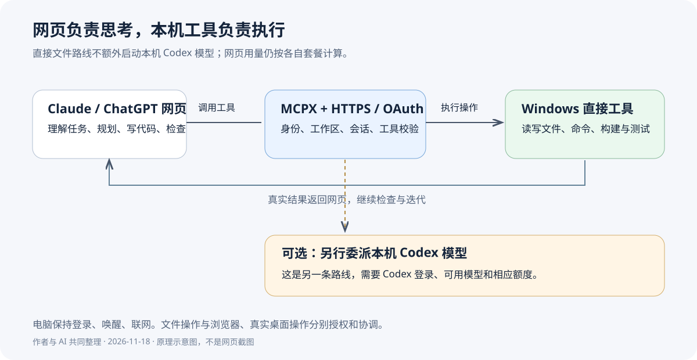

读写文件和运行命令，并不自动等于已经能控制浏览器、鼠标或任意桌面软件。要操作浏览器或桌面，还需要对应工具、明确授权和资源协调。

## 现在需要准备什么

| 条件 | 基础路线是否必需 | 普通用户怎样理解 |
| --- | --- | --- |
| Windows 电脑保持唤醒、联网 | 必需 | 电脑睡着、断网或关机时，网页不能继续访问 |
| 可用的自定义远程 MCP 网页账号 | 必需 | Claude Free 当前支持一个；ChatGPT 要先核对套餐、入口和读写权限 |
| MCPX Windows 二进制 | 必需 | 它是实际连接本机文件和命令的程序 |
| 可信 HTTPS 入口 | 必需 | 云端网页模型不能直接访问你电脑的 localhost |
| OAuth 及本地权限配置 | 必需 | 防止陌生人通过公网地址操作你的电脑 |
| 一个专用 demo 目录 | 首次验收必需 | 先改测试文件，确认整条链路真能用 |
| 自有域名 | 本文常规部署路线需要 | 给 HTTPS 和 OAuth 一个稳定地址；它不是 MCP 协议强制规定的供应商服务 |
| Cloudflare 或 VPS/FRP/Caddy | 选择一条 | 负责公网通道，不需要全装 |
| 代理 | 按网络情况 | 我们现有线路依赖可用代理；其他网络不一定需要 |
| Python | 原生路线不需要 | 我们的增强网关和监督程序才用到 |
| Git | 基础文件路线不需要 | Git worktree 隔离和 Git 项目操作才用到 |
| Codex 及其额度 | 直接工具路线不需要 | 仅在另行委派本机 Codex 模型时需要 |
| 模型 API Key | 基础路线不需要 | 网页账号负责模型推理；自选官方 Tunnel 或其他 API 服务可能另有凭据要求 |
| 管理员权限 | 默认不需要 | 只取得当前 Windows 用户已经拥有的权限 |

安装命令、配置模板和网络选择详见 [Windows 安装与联网](docs/install-windows.md)。增强方案的符号链接、固定路径和特定代理不能作为所有读者都已经具备的条件。

## 先看账号和额度规则，再花时间安装

**Claude：可以优先用免费账号验证。** 官方当前支持 Free 添加一个自定义远程 MCP 连接器。本实例当天也完成了 Free 网页账号的文件读取、新建、更新和命令验收。免费账号仍有自己的模型和使用限制，不是无限调用。[Claude 官方自定义连接器说明](https://support.claude.com/en/articles/11175166-get-started-with-custom-connectors-using-remote-mcp)

**ChatGPT：先看自己账号是否具备所需能力。** 当前官方把完整 MCP 列为 Business、Enterprise/Edu 可用，把 Pro 描述为 read/fetch。目录插件、添加入口、写工具权限不是一回事；账号灰度和工作区设置也会影响实际结果。本文历史 Pro 图片只能证明当时该账号跑通过隔离测试，不能保证所有 Plus、Pro、Free 账号今天都能写文件。[ChatGPT 官方自定义 MCP 说明](https://help.openai.com/en/articles/12584461-connecting-custom-mcp-servers-in-chatgpt)

**12 月额度合并确有公告。** OpenAI 说明 Plus、Pro、Business 从 12 月开始共享 ChatGPT 与 Codex 用量，Instant chat 不计入。公告未在本次证据中明确具体切换日和新的数额，不把它写成“12 月 1 日全量生效”。这会改变用量收益，不代表 MCPX 连接技术失效。教程应以本机操作和任务协作为价值，不能承诺永久多出一份额度。[官方用量说明](https://help.openai.com/en/articles/20001625-understanding-chatgpt-and-codex-usage-limits)

## 一次完整的上手流程

1. 检查网页账号有自定义连接器入口，并允许需要的操作。
2. 下载固定版本的官方 MCPX Windows 二进制，核对 SHA-256。
3. 建立独立运行目录和 demo 目录，填写自己的 OAuth 与权限配置。
4. 选择一条 HTTPS 通道，把 MCP 与 OAuth 发现、授权、换票路径都接通。
5. 在前台启动 MCPX，先看清错误，再考虑自动运行。
6. 网页添加自己的 HTTPS `/mcp` 地址，核对授权服务后连接。
7. 查看实际工具清单，为本对话创建业务 session；不要复用别的聊天的 session。
8. 读取 demo 文件，带最新哈希修改，回读核对，再执行一条固定 echo 命令。
9. 全部通过后配置“Windows 用户登录后自动运行”，并在锁屏、恢复网络后再次验收。
10. 按实际项目增加工具链与目录权限；运行构建、测试和部署时分别核对结果。

本文不是一键安装器。公网域名、OAuth 与服务部署步骤需要在你的环境中完成，具体命令见 [安装篇](docs/install-windows.md)。

## Claude 网页怎么接

本账号当天实际入口为“插件 → 添加 → 添加自定义连接器”。填名称和自己的 HTTPS `/mcp` 地址，发起登录后进入 MCPX 授权页。界面版本不同，也可能位于设置里的 Connectors。

添加表单用下面的文字示例说明，不另放空白表单截图。示例地址需要换成你自己部署的地址：

| 填写内容 | 示例或处理方法 |
| --- | --- |
| 连接器名称 | `Windows 本地文件`，也可以自定义 |
| 远程 MCP 地址 | `https://mcp.example.com/mcp`，保留结尾 `/mcp` |
| 登录与授权 | 发起连接后，在自己服务的 OAuth 页面确认客户端为 Claude，再完成授权 |
| 授权用口令 | 只输入自己 MCPX 服务的口令，不是 Claude 账号密码；不要贴进聊天或截图 |

字段名称可能随界面版本变化。MCPX 支持的发现和动态客户端注册可由网页完成，不需要复制另一条 ChatGPT 连接的授权或会话。

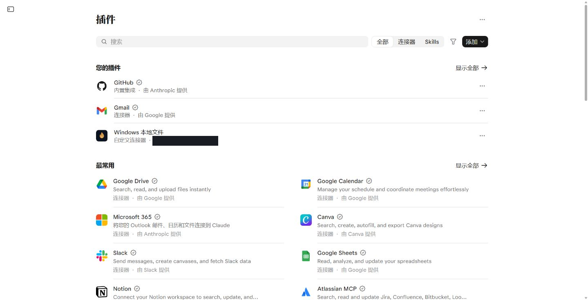

2026-11-18 实拍，聊天侧栏已收起，自用域名已遮挡。可看到已经添加的“Windows 本地文件”。

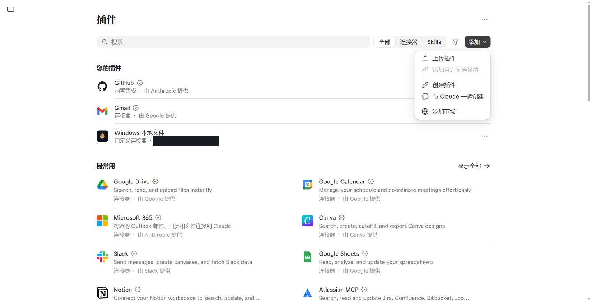

如果“添加自定义连接器”是灰色，先检查是否已有一个连接器。图中的 Free 账号已经连接了“Windows 本地文件”，因此保留现有连接，直接进入详情页继续使用。禁用状态不能单独证明网络故障。

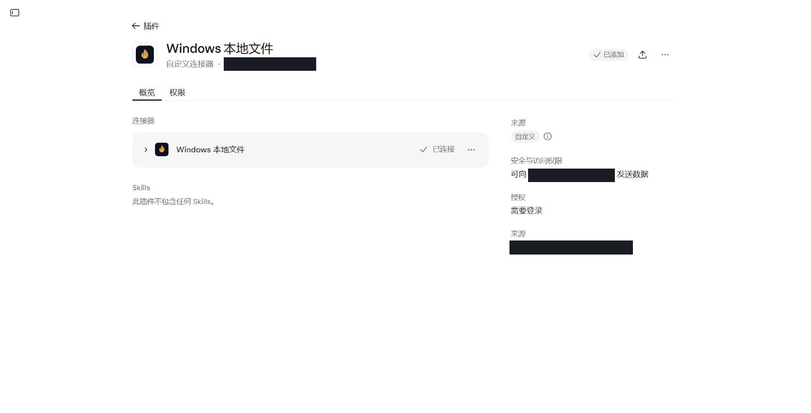

现有连接详情，自用域名已遮挡。“已连接”表示认证连接状态，接下来还要验收工具能否实际修改测试文件。

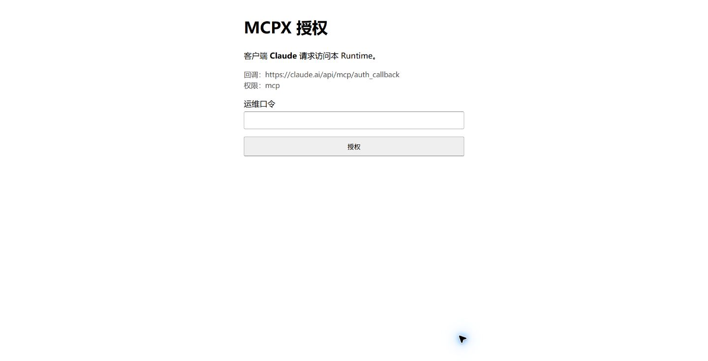

这张 11 月 18 日留存图中口令为空。`claude.ai` 是官方回调，不是个人域名。新增本机访问权限时要按实际范围确认。

授权后，先核对工具目录。有缓存时用“更多选项 → 刷新工具列表”，再开新对话。下图是我们增强网关的权限页，工具名以 `windows_*` 开头；普通原生 MCPX 的名称不同。

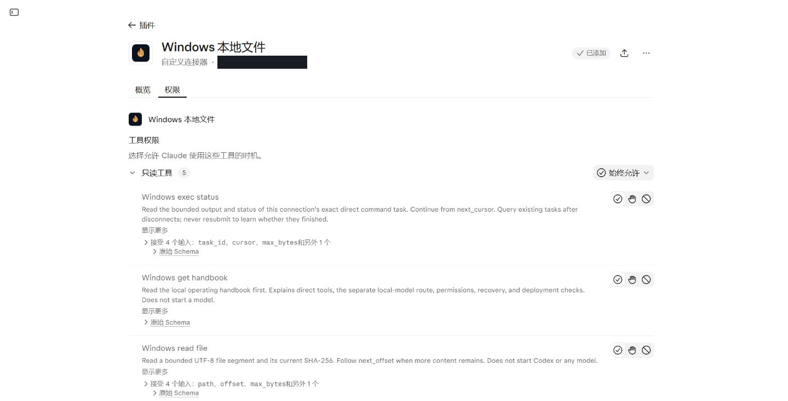

图中有 5 个只读工具，侧栏已收起，自用域名已遮挡。“始终允许”是个人实例已经授予的权限；第一次部署建议先保留写入确认。

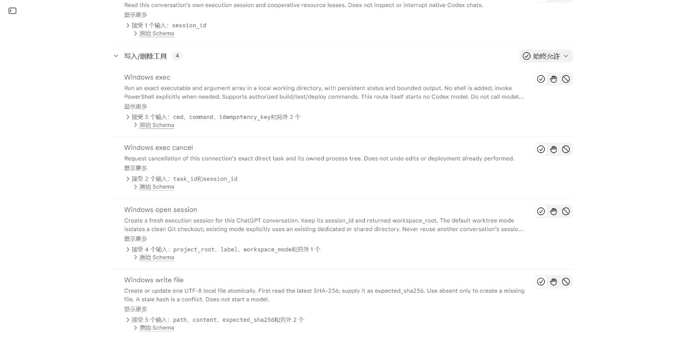

向下还有 4 个写入工具，可见 `windows_open_session`、`windows_write_file` 和带 `session_id` 的任务取消接口。直接路线不启动本机 Codex。会话参数用于保持操作归属，不应为了省步骤而省略。

在专用目录验收后，结果如下：

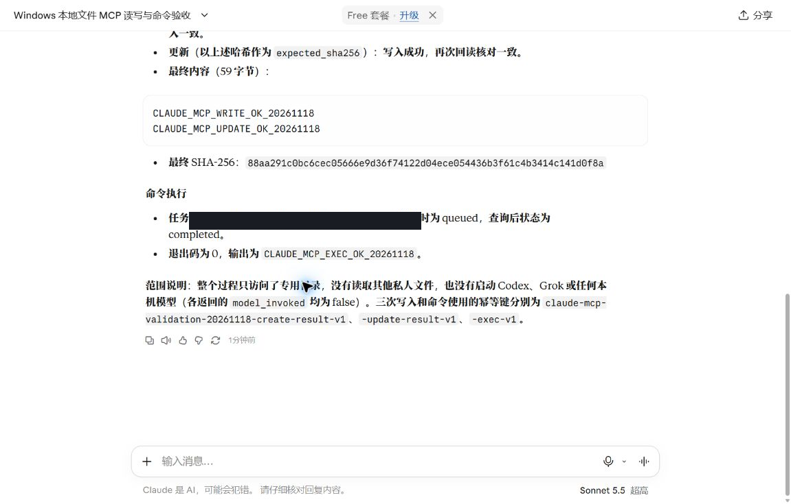

顶部保留了 Free 标识。创建与哈希更新成功、回读一致；命令 completed、退出码 0。对应文件已在本机核对。任务标识和私人区域经过遮挡/裁切；这是 2026-11-18 的验收留存图。详细步骤见 [Claude 篇](docs/claude.md)。

## ChatGPT 网页怎么接

先核对账号能力，在“插件/Plugins”入口添加自定义 MCP，填自己的服务地址并完成 OAuth。新入口不统一要求先打开旧版 Developer Mode。工作区可能需要管理员允许。

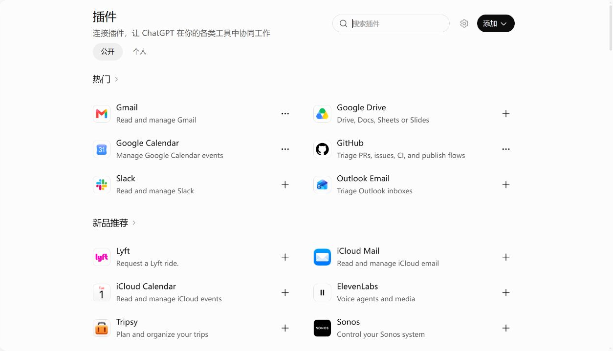

2026-11-18 实拍。左侧账户图标列已裁掉；网页入口有“添加”和“管理”。

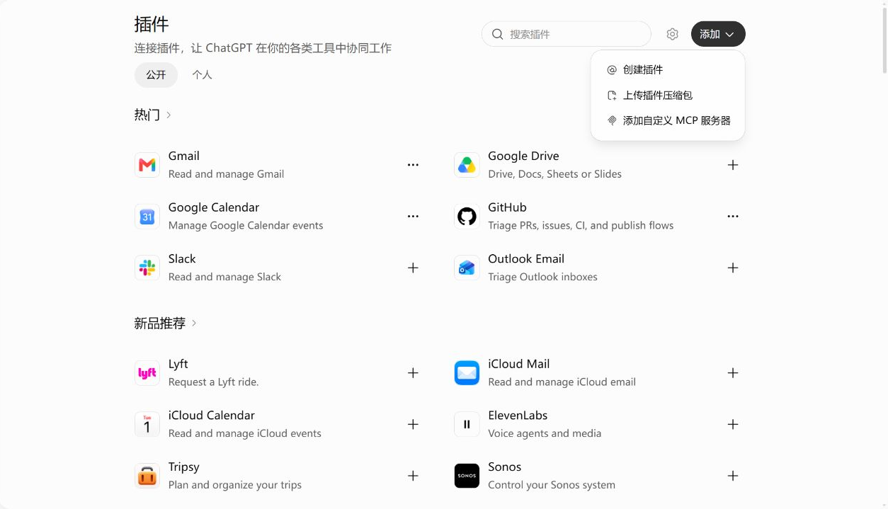

选择“添加自定义 MCP 服务器”。这一步不要求重新打开旧版 Developer Mode，实际可用能力仍按账号和工作区权限判断。

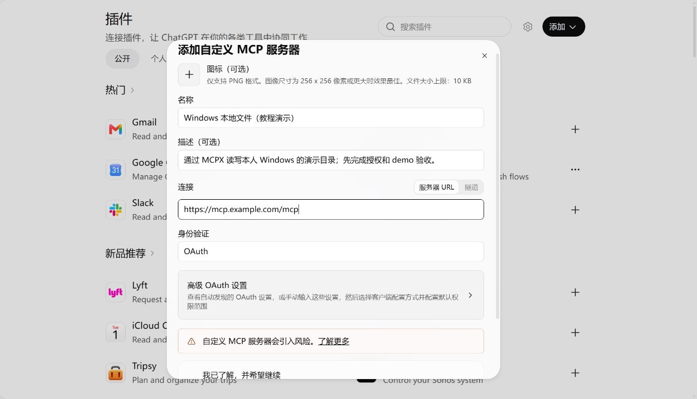

表单演示填写了示例域名 `mcp.example.com` 并保留 OAuth，停在风险确认和提交之前。请换成自己已部署的地址，核对授权范围后完成连接。描述文字不会替代服务端目录或命令限制。

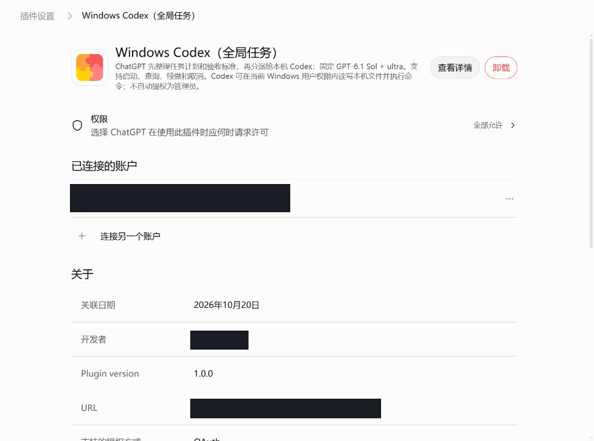

这是作者已有的增强插件，账户、开发者姓名和自用域名已遮挡。界面保留了历史插件名与模型分派描述；日常直接操作应按实际目录选择 `windows_*`，不能由插件名称推断每次都要启动 Codex 模型。

连接成功还不等于工具已同步。新对话选择插件，核对实际工具清单和 schema，再建立本对话的 session。原生工具和增强 `windows_*` 的参数不能混用。

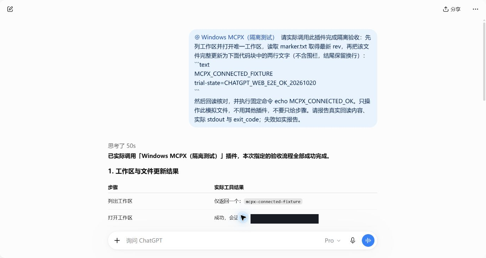

这张证明 10 月 20 日当时的隔离测试成功，不作为今天账号已重新完成写入测试的证据。详细步骤和现行账号条件见 [ChatGPT 篇](docs/chatgpt.md)。

## 平时给模型怎样下任务

原生 MCPX 可以这样说：

```text
使用我已连接的 MCPX。先查看真实工具清单和参数，选择 demo 工作区，
为本对话创建自己的 Remote Session，并保存完整 remote_session_id。
先读取 marker.txt 及最新 SHA，再按这个 SHA 更新为 MCPX_WRITE_OK，回读验证。
只执行配置允许的 echo MCPX_CONNECTED_OK，报告真实输出与退出码。
使用直接文件和命令工具，不调用本机 Codex 或其他模型，不访问其他目录。
遇到权限、哈希冲突或不确定执行结果时先查询和报告，不绕过校验。
```

如果连接的是增强网关，应先读操作手册，再调用 `windows_open_session`，后续保存 `session_id` 与 `workspace_root`。完整两套提示词见 [直接工具 SOP](prompts/direct-tools-sop.zh.md)。

做项目时，先让网页模型分析目标和验收标准，再用直接工具改文件、构建和检查，最后根据结果迭代。只有明确选择“委派本机模型”时才启动 Codex。浏览器、部署凭据和远程服务器都需要对应能力与授权，不是安装 MCPX 后自动取得。

可以把真实项目任务写成下面这样。先把目录、目标和允许动作换成自己的要求：

```text
项目：C:/MCPX/my-app
目标：修复【具体问题】，验收标准是【预期行为】。

先检查当前项目与未提交修改，再给出简短实施计划。
为本对话创建独立执行会话，默认使用直接文件和命令工具。
在我已授权的项目范围内完成修改、运行相关检查，根据结果继续修复。
修改前读取最新文件版本；冲突时合并，保留其他会话的改动。
只有我明确要求模型委派时，才把任务另交给本机 Codex 模型。
完成后报告实际改动、检查结果和剩余问题；部署按我明确指定的环境执行。
```

这样可以让网页端模型先思考、再执行和迭代。给本地 Codex 准备整套环境时，使用 [Codex 安装 SOP](prompts/codex-install-sop.zh.md)；已经接通后，则用 [日常直接工具 SOP](prompts/direct-tools-sop.zh.md)。

## 电脑要保持怎样的状态

我们当前部署是“当前用户登录后自动运行”，不是无人登录的开机服务。文件/命令路线一般可以在锁屏、关显示器或关闭网页后继续提供服务；电脑必须保持唤醒、联网和后台进程正常。注销、睡眠、休眠、关机会中断。真实桌面与鼠标键盘操作还有前台登录会话要求。

手机浏览器若能实际选择并调用该连接器，操作目标仍是 Windows；不是修改手机里的文件。本次没有完成手机端验收，不能承诺所有移动端界面都支持。

多个聊天可以各自有 session，但同一文件仍可能冲突；使用 worktree、修改前哈希校验和任务归属。桌面鼠标键盘应排队，浏览器用各自的任务标签页。网络重连后先查原 Task ID，不能为了知道“跑没跑”而再次部署。

## 教程包与验证范围

教程内容已完成，包含配置模板、安装和日常使用提示词、15 张脱敏实拍、一张原理图和验证说明。Claude 添加表单采用文字填写示例，现有连接保留。包中不包含作者私有网关、真实授权、运行数据库、令牌或用户文件。

本实例已验证 Claude Free 的直接读写和命令执行，并核对了两端当前入口、ChatGPT 示例表单、已有连接与 Claude 工具权限。ChatGPT 的写入成功截图来自历史隔离测试。全新 Windows 安装、手机端、当前 ChatGPT 账号的新建授权和写入全流程没有在本文中重新实测；这不影响按步骤阅读，但不能把它们当作已经通过的验收。各图片的覆盖范围见 [截图说明](docs/screenshots.md)。

GitHub 教程首版为 [mcpx-web-local-guide v0.1.0](https://github.com/7yedeng/mcpx-web-local-guide/releases/tag/v0.1.0)，原创内容采用 [MIT License](LICENSE)。最初上游、其他参考方案及借鉴范围见[致谢与来源](ACKNOWLEDGEMENTS.md)和[第三方说明](THIRD_PARTY_NOTICES.md)。

源码与产品规则来源见 [来源与验证范围](docs/sources-and-validation.md)。MCPX 原项目作者保留原项目权利；本教程由作者与 AI 共同整理。
