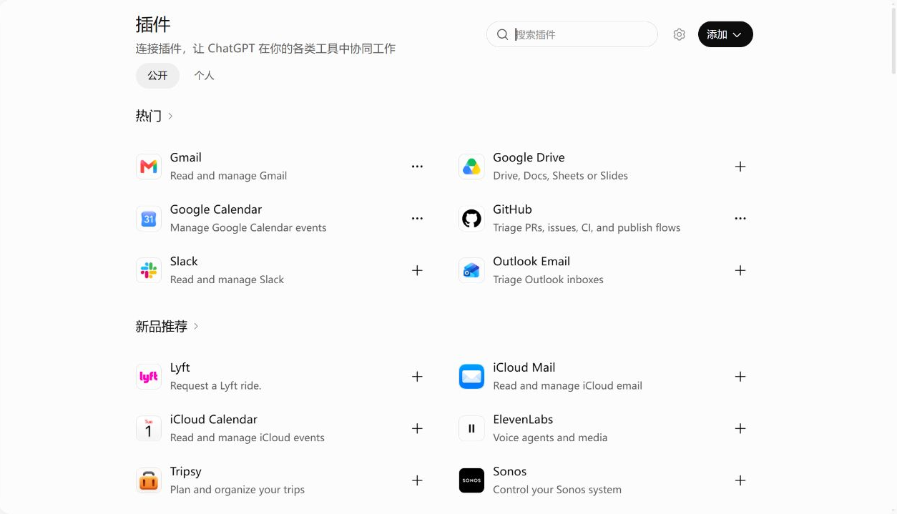
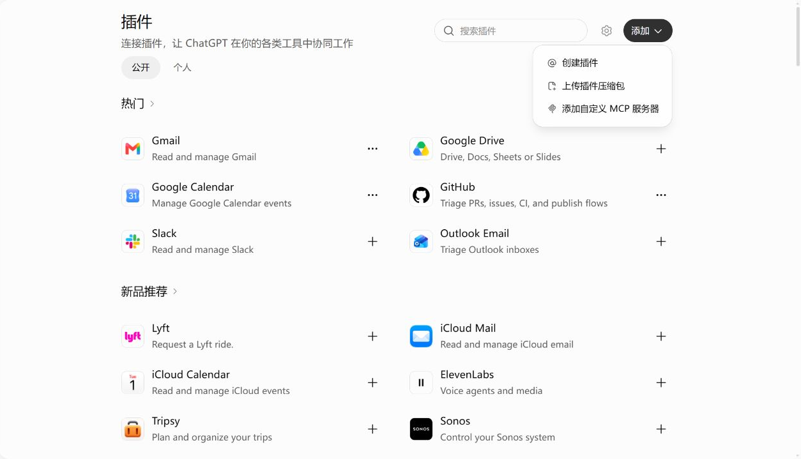
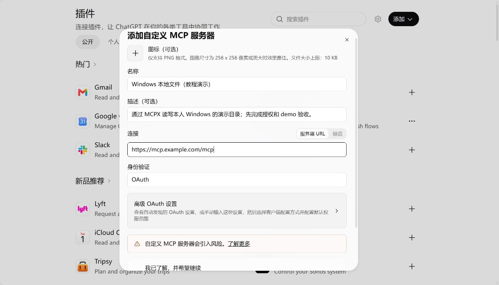
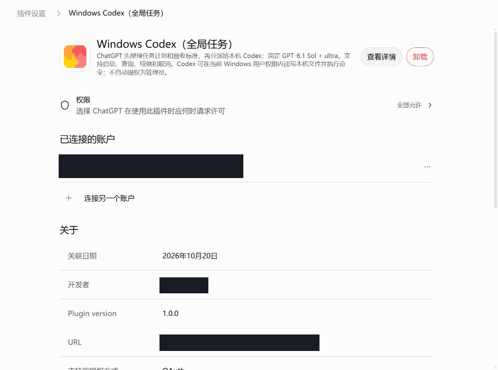
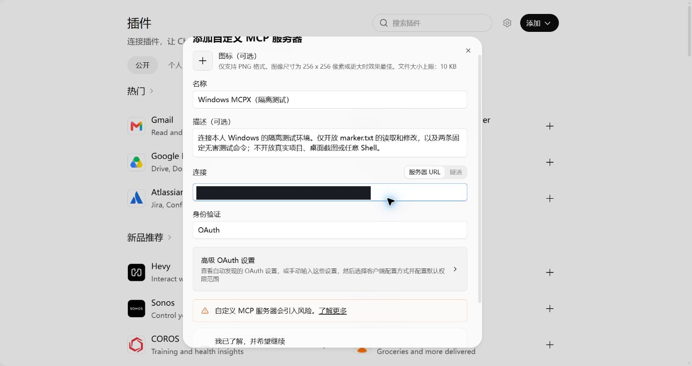
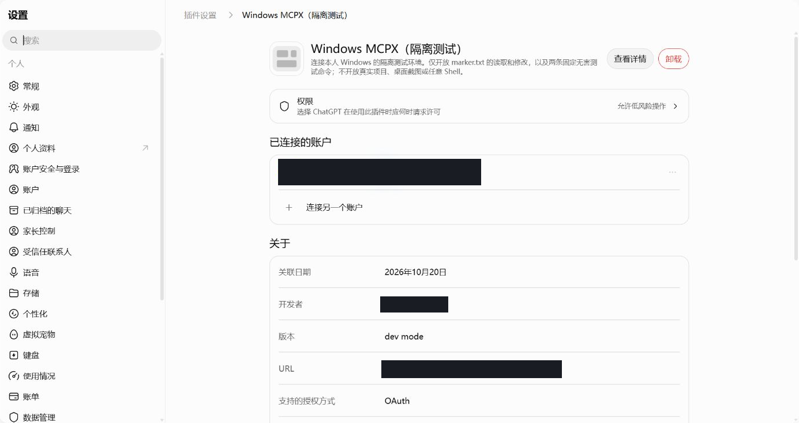
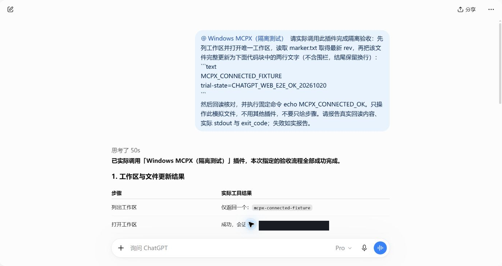

# ChatGPT 网页：先核对账号能力，再添加 MCP

核对日期 2026-11-18。本文与 AI 共同整理。当前入口、示例表单和已有连接详情为本轮补拍；文末保留的历史图明确标记为 2026-10-20。账户、自用域名与会话标识均已处理。

## 1. 先判断账号是否支持你需要的操作

当前官方自定义 MCP 说明对不同套餐区分了读取与完整读写能力。不要把目录插件可用、出现“添加”按钮和允许写入/执行视为同一个结论。以 [Connecting custom MCP servers in ChatGPT](https://help.openai.com/en/articles/12584461-connecting-custom-mcp-servers-in-chatgpt) 的当前套餐范围、工作区管理员设置和真实工具目录为准。

本仓库中的历史 Pro 成功图只证明当时该账号的隔离插件可用，不保证今天所有 Pro/Plus/Free 账号拥有相同写入能力。若写入或执行被产品限制，服务器改成另一个名称或伪装只读也不能作为解决办法。

## 2. 添加自定义远程 MCP

1. 完成 [Windows 与 HTTPS 准备](install-windows.md)。
2. 在网页“插件/Plugins”中选择添加自定义 MCP；新入口按当前官方流程操作，不统一要求先打开旧版 Developer Mode。
3. 填名称、自己的公网 MCP URL `https://mcp.example.com/mcp`，选择服务实际支持的 OAuth。
4. 核对授权页的服务和权限范围，再授权。工作区账号可能需要管理员允许自定义 MCP。
5. 在新对话选择该插件，查看工具目录与 schema，建立本对话的业务 session，再开始验收。

本轮使用公开占位地址 `https://mcp.example.com/mcp` 填写演示，保留 OAuth，没有勾选风险确认或提交创建。图片证明表单可以打开与填写，不证明新连接或当前账号的写入操作已完成。

当前已有增强插件的连接详情，个人信息和自用域名已遮挡。没有为截图重建授权。插件名称及历史描述中的 Codex 模型分派，与实际 `windows_*` 直接工具是两条路线；`Plugin version` 也不等于运行手册或工具 schema 的版本。

### 历史界面参考

历史隔离测试界面。黑色块遮挡自用域名；填写时使用你自己的地址。截图里限制 marker.txt 的策略属于当时的隔离网关，不是填上同样描述就自动产生权限限制。

历史连接结果。账户名、头像、开发者姓名和自用域名已遮挡；浏览器侧栏图标列已裁掉。连接成功后，仍需验收工具实际读改结果。

## 3. 真实验收与工具清单同步

2026-10-20 历史隔离验收。服务端返回的会话标识已遮挡。它证明当时可调用隔离工具，不代表本轮已在当前 ChatGPT 账号重新完成写入测试。

原生 MCPX 使用 `workspace/session/read/edit/execute` 等工具；我们的增强网关使用 `windows_get_handbook/windows_open_session/...`。先看实际目录，不能要求模型调用一个服务没有公开的名字。

更新服务后，若旧聊天仍只有旧入口，检查服务端实际 `tools/list` 与客户端看到的 schema，刷新插件工具，再开新对话验证。保留 session、工作区、身份和资源校验，不为兼容旧聊天恢复绕过校验的写入口。

## 4. 12 月额度变化怎样影响这套方法

OpenAI 当前官方说明：从 12 月开始，Plus、Pro、Business 的 ChatGPT 与 Codex 共享用量额度；Instant chat 不计入。不要推定未明确写出的具体日期，也不要承诺所有工具调用都按 Instant 对待。[官方用量说明](https://help.openai.com/en/articles/20001625-understanding-chatgpt-and-codex-usage-limits)

因此教程的价值是“网页模型经工具操作本机、可选是否委派给另一个模型”，而不是保证增加一份额度。直接文件/命令路线不额外启动本机 Codex 推理，网页模型和它使用的工具仍受网页产品规则限制。合并用量不会从技术上取消 MCPX，但可能改变哪条路线更划算。
