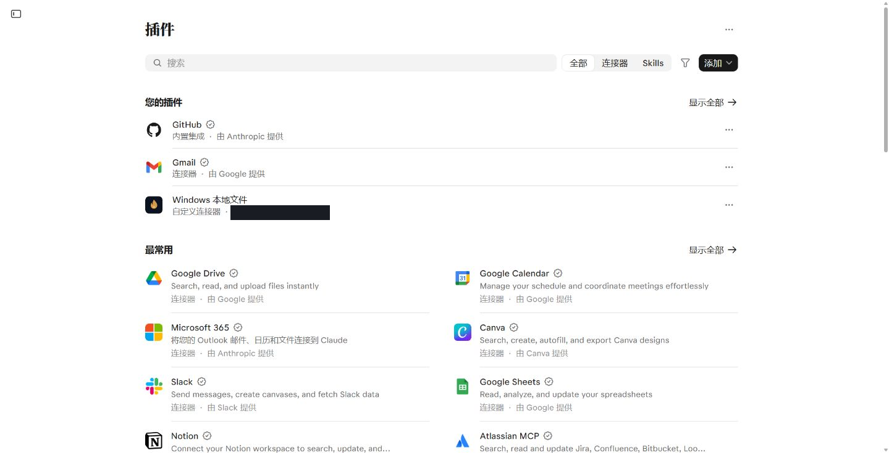
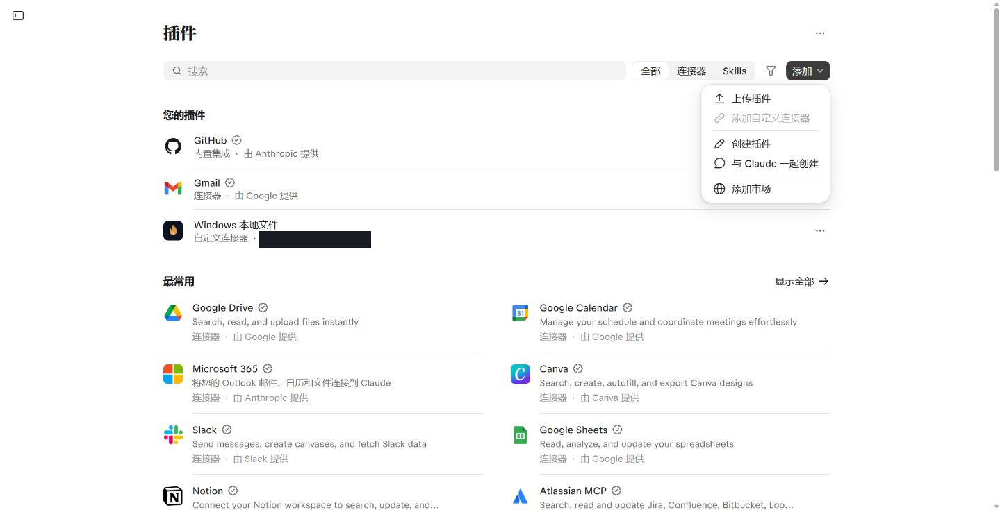
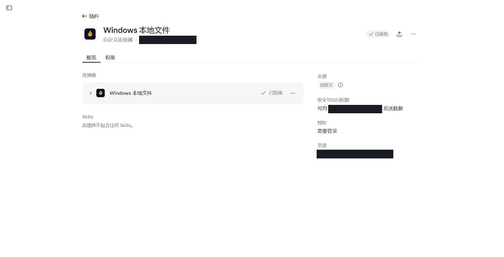
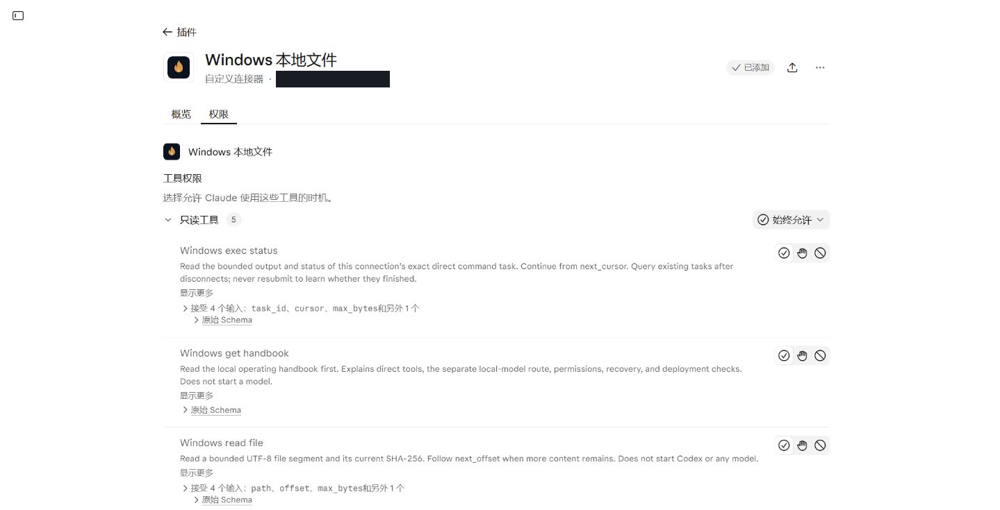
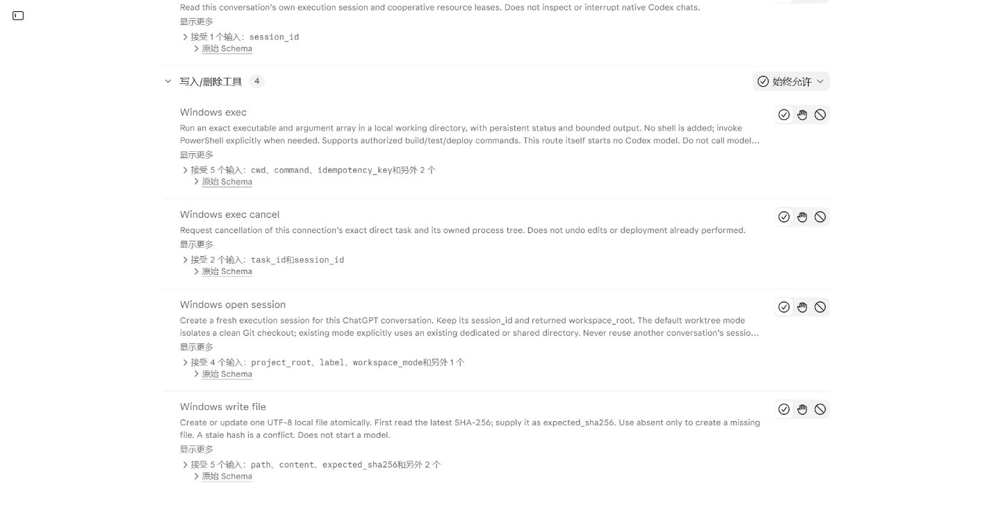
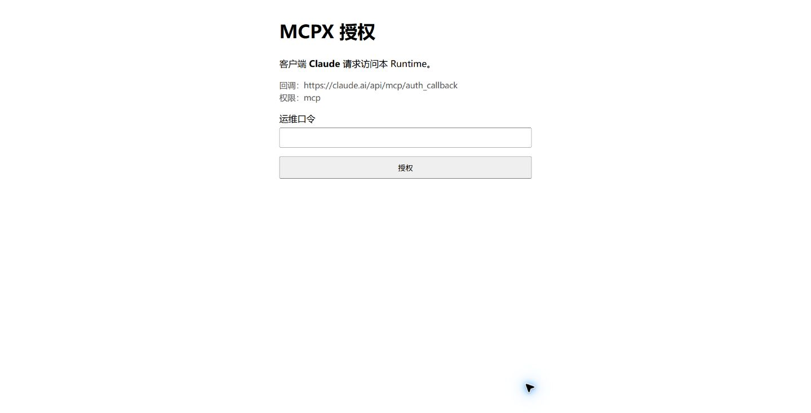
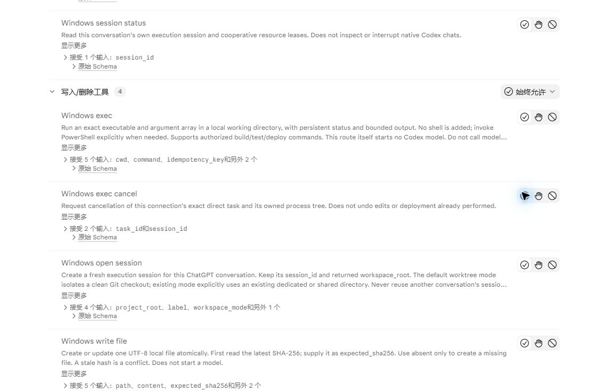
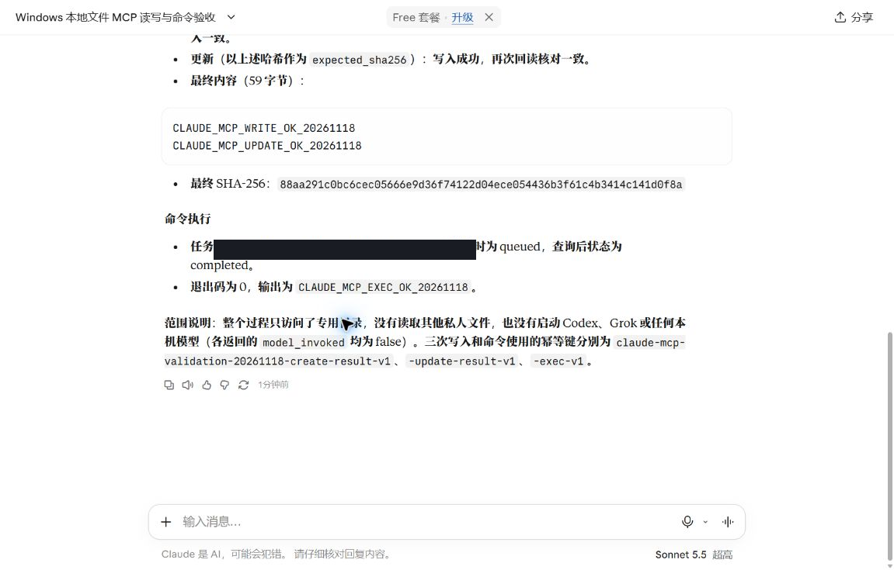

# Claude 网页：添加连接器与验收

核对日期 2026-11-18。本文与 AI 共同整理。官方说明与本账号实例分别列出。

## 账号条件

Claude 官方当前允许 Free 使用自定义远程 MCP，Free 限 1 个自定义连接器。免费不等于无限模型额度；连接器调用、模型可用性和使用限制仍服从账号规则。

官方入口和要求见 [Claude 自定义远程 MCP 帮助](https://support.claude.com/en/articles/11175166-get-started-with-custom-connectors-using-remote-mcp)。界面可因语言和版本显示“插件”或“连接器”。

## 从添加到实际操作

1. 完成 [Windows 与 HTTPS 准备](install-windows.md)，先确认认证地址可访问。
2. Claude 网页打开“插件/连接器”，选择“添加 → 添加自定义连接器”。不同版本可能在设置里的 Connectors 页面。
3. 名称填自己容易识别的名称；地址填自己的 `https://mcp.example.com/mcp`。
4. 发起连接，确认 OAuth 页面上的客户端为 Claude、地址属于自己部署的服务。**添加一个新连接器会授予它本机访问能力，按实际范围确认后才授权。** 不把 OAuth 口令或令牌发到聊天里。
5. 新对话启用连接器，查看实际工具列表，按只读和写入工具分别设置权限。教程先用逐次确认；不要照着下面个人实例的“始终允许”一键扩权。
6. 只在 demo 目录完成读、改、回读、echo 命令验收，再按实际任务逐步扩大范围。

## 添加表单的文字填写示例

这一小步使用文字说明，不放空白表单截图。保留作者已经接通的连接，不为配图删除或重建授权。

| 内容 | 怎么填 |
| --- | --- |
| 名称 | `Windows 本地文件`，也可以填写自己容易识别的名称 |
| 远程 MCP 地址 | 自己的 HTTPS 地址，例如 `https://mcp.example.com/mcp` |
| 登录授权 | 发起连接后，核对自己 MCPX 的 OAuth 页面和 Claude 客户端，再完成授权 |
| MCPX 口令 | 输入为该服务设置的口令，不是 Claude 账号密码；口令不进入截图和聊天 |

字段名称以你看到的版本为准。首次没有连接器时按上述流程添加；已经有一个且入口禁用时，先检查 Free 的数量限制，已有连接可直接继续用。

## 本轮补拍：入口、数量限制与现有连接

图中账号已有一个自定义连接器，新增入口为 disabled，与 Free 当前限一个的规则相符。教程选择保留现有连接；添加表单使用上面的文字示例说明。

本轮重新查看到 5 个只读工具、4 个写入工具。图中直接路线没有新增 Codex 模型调用，既有权限未修改；本轮界面核对不替代下面同日已经完成的文件和命令验收。

## 留存截图：OAuth 授权页

2026-11-18 同日留存实拍。口令框为空；图中的 `claude.ai` 是官方回调域名，保留用于识别客户端，不是作者自用服务域名。

## 留存截图：工具目录与权限

2026-11-18 同日留存实拍，已裁掉聊天侧栏和账户区域。图中 `windows_*` 来自增强网关，**不属于原生 MCPX 工具名**。截图展示个人实例已经授予的权限，不作为初次部署推荐值。

工具清单若仍是旧目录，先在连接器菜单使用“刷新工具列表”，再开新对话。不要恢复没有 session 校验的旧写接口。

## 本账号 Free 实例的真实结果

2026-11-18 留存实拍，顶部可见 Free。任务标识已遮挡，左侧私人聊天和账户区域已裁掉。此图是既有验收记录的结果部分，不是本轮重新录制全流程。

本地检查对应结果文件的两行标记和 SHA-256 一致：创建、更新成功，命令 completed，退出码 0。直接执行路线没有启动本机 Codex 模型。

本案例使用已有 Windows 增强网关，它只向本次精确授权的 Claude 连接公开 9 个直接工具，没有公开 Codex/Grok 模型派发入口。新 OAuth 授权不会自动继承旧连接的目录和会话权限。原生 MCPX 的工具目录和权限管理不同，不能照抄这 9 个工具名称。

## 手机、锁屏与并行

在手机浏览器也需要实际存在并可选择该连接器；连接器请求仍落在 Windows，不会取得手机文件。当前留存验收覆盖桌面 Chrome 中的 Claude Free，没有验证手机端完整流程。

Windows 需保持登录、唤醒、联网。网页标签关闭不等于本机后台停止；真实桌面操作需单独协调前台和焦点，文件路线不自动提供浏览器控制。
